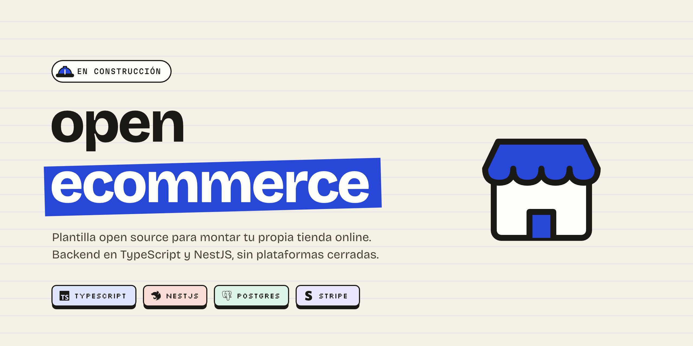

<div align="center">



<br>

**Una tienda online que es tuya de verdad: tu código, tus datos y tus clientes.**


[Qué es](#qué-es) · [Hoja de ruta](#hoja-de-ruta) · [Cómo está hecho](#cómo-está-hecho) · [Empezar](#empezar) · [Decisiones](#decisiones-de-diseño)

</div>

<br>

## Qué es

**openecommerce** es una plantilla open source para montar una tienda online sin empezar de cero y sin depender de una plataforma cerrada. La descargas, la configuras y vendes lo tuyo: catálogo, carrito, usuarios, pedidos y pagos.

El foco está en el **backend**: una API sólida, segura y bien probada, pensada para los problemas que aparecen cuando una tienda vende de verdad.

| El problema | Cómo lo resuelve |
| --- | --- |
| `0.1 + 0.2` no da `0.3` y los totales se descuadran | Todos los precios van en **céntimos enteros** |
| Dos personas compran la última unidad a la vez | **Transacciones** y control de stock en la base de datos |
| Stripe avisa dos veces del mismo pago | **Webhooks idempotentes**: cobrar una vez, aunque el aviso llegue dos |
| Un error en el carrito deja datos a medias | El dominio **nunca modifica el original**: cada operación devuelve un estado nuevo |
| Un producto cambia de precio y los pedidos antiguos dejan de cuadrar | Cada pedido **copia nombre y precio** en el momento de la compra |

> [!NOTE]
> El proyecto está en construcción y avanza por fases. Este README se actualiza al cerrar cada una.

## Hoja de ruta

**Fase 1 · Núcleo del dominio** <sub>en curso</sub>

- [x] Modelo de producto con precios en céntimos
- [x] Catálogo: buscar por id, filtrar por categoría y ordenar por precio
- [x] Carrito inmutable: añadir, quitar y cambiar cantidad
- [x] Comprobaciones del carrito con errores propios
- [x] Catálogo asíncrono con caché
- [x] Subtotal, descuentos y cupones
- [x] Pedido inmutable: checkout desde el carrito y estados pendiente → pagado → enviado
- [x] TypeScript estricto en todo el núcleo
- [ ] Repositorio genérico en memoria
- [ ] Validación de datos externos con Zod
- [ ] Tests con Vitest

**Siguientes fases**

- [ ] **API REST** con NestJS: validación, errores coherentes y documentación con Swagger
- [ ] **Base de datos:** PostgreSQL con Prisma
- [ ] **Usuarios:** registro, login con JWT, roles y seguridad (OWASP)
- [ ] **Pedidos:** transacciones, control de stock y concurrencia
- [ ] **Pagos** con Stripe: checkout y webhooks idempotentes
- [ ] **Colas y caché** con Redis
- [ ] **Tienda web** con Next.js y shadcn/ui, y panel de administración
- [ ] **Producción:** Docker, CI con GitHub Actions y despliegue en AWS

## Cómo está hecho

```
src/
├── producto.ts          Tipo Producto y categorías
├── catalogo.ts          Catálogo y consultas sobre él
├── catalogo-remoto.ts   El catálogo como si viniera de un servidor: promesas y caché
├── carrito.ts           Carrito inmutable: añadir, quitar y cambiar cantidad
├── carrito-seguro.ts    Comprueba stock y cantidades antes de tocar el carrito
├── descuentos.ts        Subtotal, descuentos por porcentaje y cupones
└── pedido.ts            Checkout: convierte el carrito en un pedido y lo avanza de estado
```

El núcleo no depende de ningún framework: son funciones puras en TypeScript. Cuando llegue NestJS, la API envolverá este núcleo en lugar de reescribirlo.

### Stack

| Capa | Tecnología |
| --- | --- |
| Lenguaje | TypeScript en modo `strict` |
| Backend | NestJS |
| Base de datos | PostgreSQL + Prisma |
| Pagos | Stripe |
| Caché y colas | Redis |
| Frontend | Next.js + shadcn/ui |
| Tests | Vitest |
| Infraestructura | Docker, GitHub Actions y AWS |

## Empezar

**Requisitos:** Node.js 24 o superior y npm.

```bash
git clone https://github.com/angelgmx/ecommerce.git
cd ecommerce
npm install
npm run check
```

| Script | Qué hace |
| --- | --- |
| `npm run dev` | Ejecuta el proyecto |
| `npm run check` | Revisa los tipos con TypeScript |

Cada módulo se puede ejecutar por separado con Node, por ejemplo `node src/catalogo-remoto.ts`.

## Decisiones de diseño

Cada decisión importante se documenta como un ADR (*Architecture Decision Record*): qué problema había, qué opciones se valoraron, cuál se eligió y qué se pierde con ella. Se publicarán en `docs/adr/`.

Las primeras:

- **Precios en céntimos**, en lugar de números con decimales.
- **Un inquilino o multi-inquilino**: si cada tienda tiene su propia instalación o si muchas tiendas comparten una.

## Contribuir

Las ideas y los fallos encontrados son bienvenidos: abre un *issue* contando qué esperabas y qué pasó. Para cambios de código, abre primero un *issue* para comentarlo.

## Licencia

[MIT](LICENSE): puedes usarlo, modificarlo y venderlo, siempre que mantengas el aviso de copyright.

<br>

<div align="center">

Hecho por **[Ángel Gómez](https://github.com/angelgmx)**

</div>
