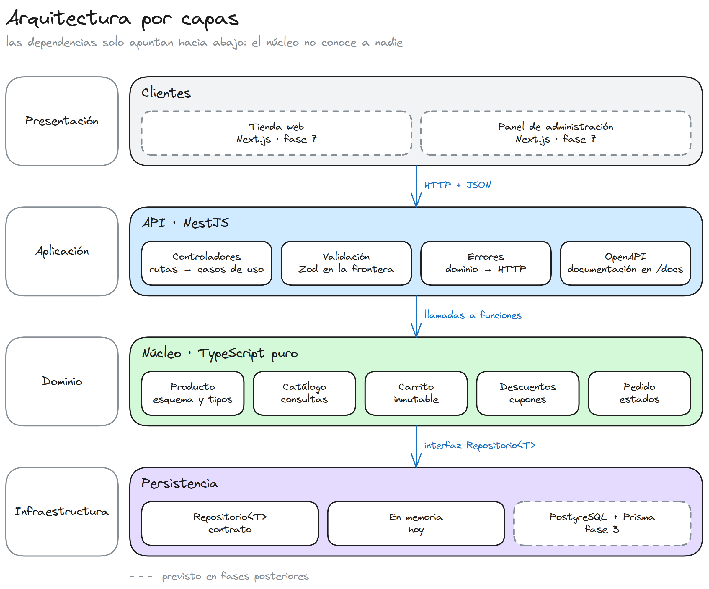
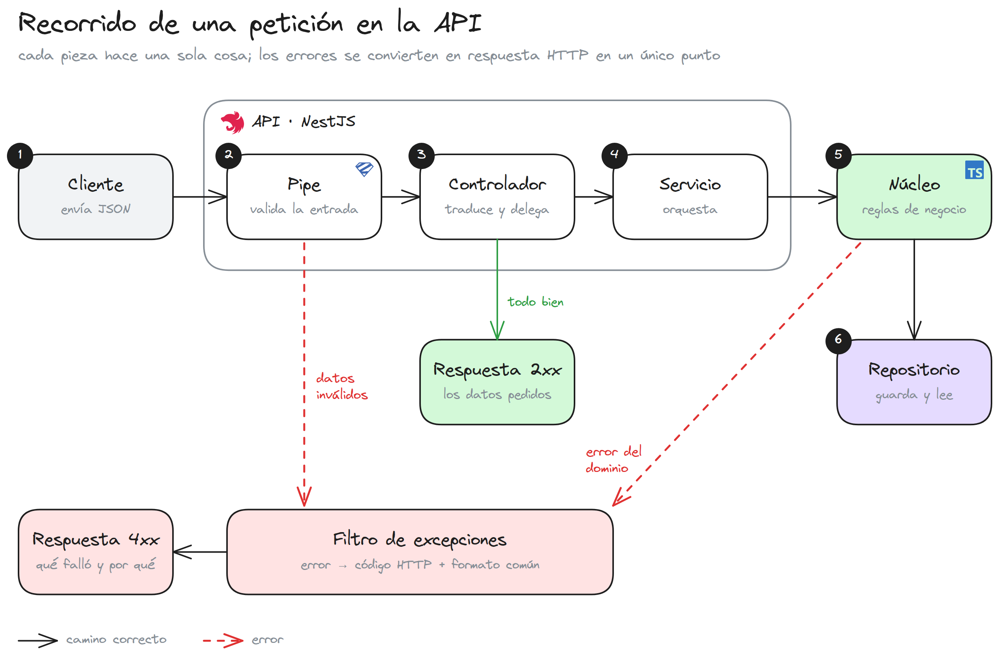
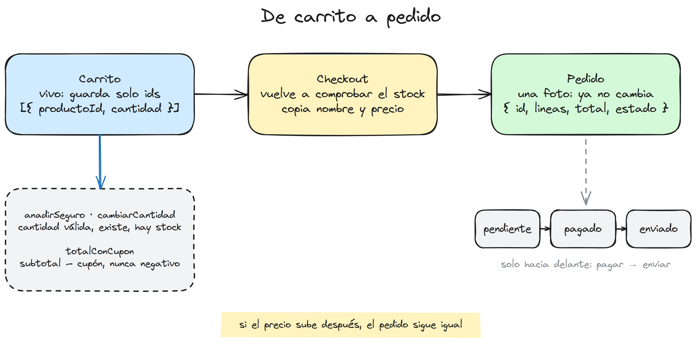
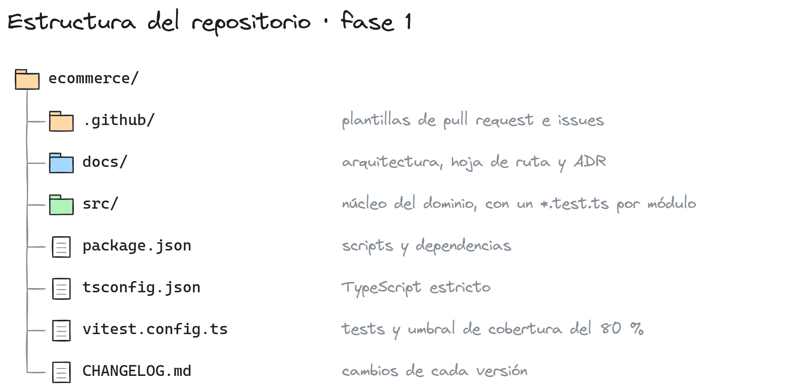
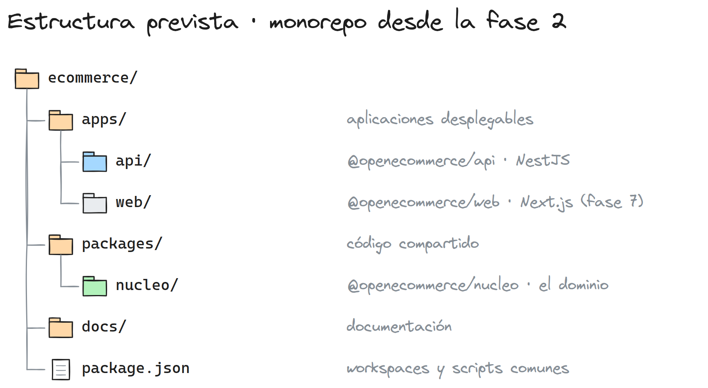
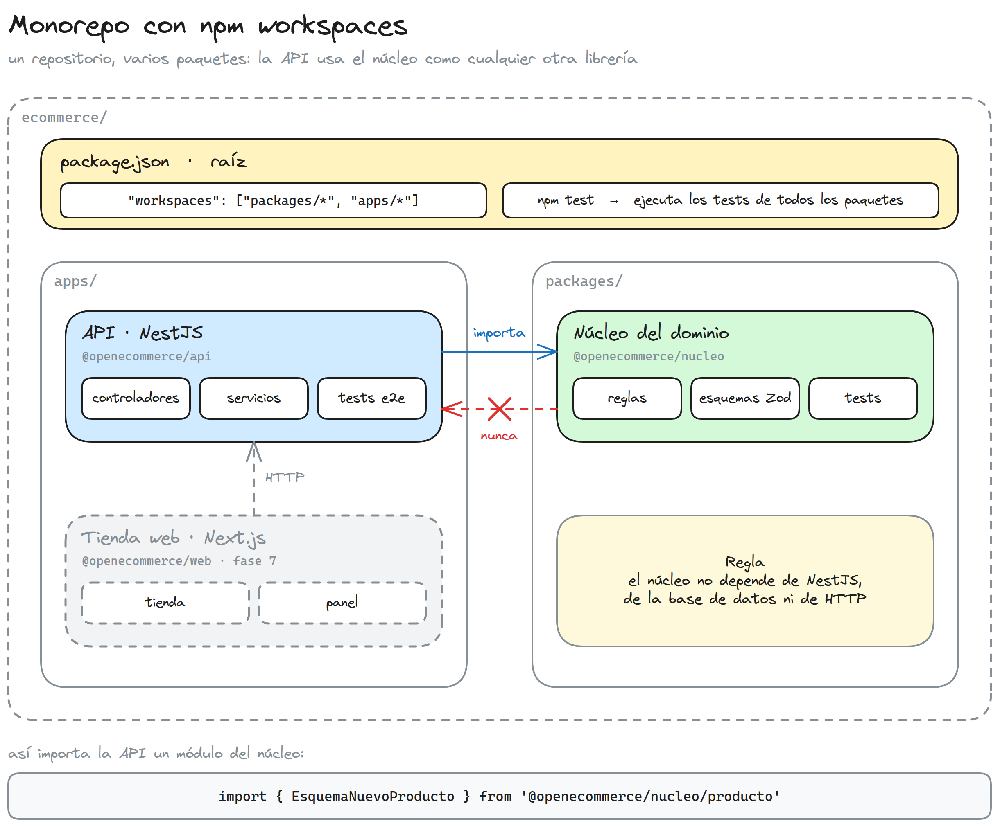

openecommerce separa **qué hace una tienda** (el dominio) de **cómo se expone y dónde se guarda** (la infraestructura). Las reglas de negocio no dependen de ningún framework, base de datos ni proveedor de pagos.

## Documentos

Esta página es la visión general. Cada parte del sistema tiene su documento, que se completa en la fase en la que se construye:

| Documento | Contenido | Estado |
| --- | --- | --- |
| Visión general (esta página) | Capas, módulos del núcleo, flujo de compra, principios y estrategia de pruebas | vigente |
| [`api.md`](api.md) | Contrato de la API: recursos, rutas, códigos de estado y formato de error | fase 2 |
| [`modelo-de-datos.md`](modelo-de-datos.md) | Entidades, relaciones, restricciones e índices | fase 3 |
| [`seguridad.md`](seguridad.md) | Autenticación, autorización y revisión frente al OWASP Top 10 | fase 4 |
| [`pagos.md`](pagos.md) | Flujo de pago, webhooks e idempotencia | fase 6 |
| [`despliegue.md`](despliegue.md) | Infraestructura en AWS, entornos y observabilidad | fase 9 |

## Capas

| Capa | Responsabilidad | No debe |
| --- | --- | --- |
| **API** | Traducir HTTP al dominio y de vuelta: rutas, validación de entrada, códigos de estado, documentación OpenAPI | Contener reglas de negocio |
| **Núcleo** | Las reglas de la tienda: stock, cantidades, descuentos, estados del pedido | Importar NestJS, Prisma ni nada de infraestructura |
| **Persistencia** | Guardar y recuperar datos detrás de la interfaz `Repositorio<T>` | Decidir qué es válido para el negocio |

La dependencia va siempre hacia dentro: la API conoce el núcleo, el núcleo no conoce la API. Así, cambiar de framework o de base de datos no toca las reglas de negocio, y el núcleo se prueba con tests unitarios que no necesitan levantar nada.

### Recorrido de una petición

Toda entrada se valida antes de llegar al controlador; los errores del dominio se traducen a HTTP en un único punto. El controlador solo traduce y delega.

## Módulos del núcleo

| Módulo | Responsabilidad |
| --- | --- |
| `producto.ts` | Esquema de Zod del producto y tipos derivados (`Producto`, `NuevoProducto`, `Categoria`); cupones |
| `producto-entrada.ts` | Convierte un JSON externo en un `NuevoProducto` validado o en la lista de errores |
| `catalogo.ts` | Consultas sobre el catálogo: buscar, filtrar y ordenar |
| `catalogo-remoto.ts` | El catálogo como fuente asíncrona, con caché |
| `carrito.ts` | Operaciones inmutables del carrito: añadir, quitar y cambiar cantidad |
| `carrito-seguro.ts` | Las mismas operaciones comprobando cantidad, existencia y stock; lanza `ErrorCarrito` |
| `descuentos.ts` | Subtotal, descuentos por porcentaje y cupones |
| `pedido.ts` | Checkout y ciclo de vida del pedido: `pendiente → pagado → enviado` |
| `repositorio.ts` | Contrato `Repositorio<T>` y su implementación en memoria |

## Flujo de una compra

- El **carrito** guarda solo identificadores: el precio se consulta siempre en el catálogo actual.
- El **pedido** es una fotografía: copia nombre y precio en el momento de la compra, así que un cambio de precio posterior no altera pedidos antiguos.
- Los estados solo avanzan. Un pedido no se edita: cada transición devuelve uno nuevo.

## Principios

| Principio | Motivo | Referencia |
| --- | --- | --- |
| Importes en céntimos enteros | La aritmética de coma flotante descuadra los totales (`0.1 + 0.2 !== 0.3`) | Fase 1 |
| Estado inmutable en el núcleo | Sin efectos secundarios ni datos a medias si una operación falla | [ADR-0003](../adr/0003-estado-inmutable-en-el-nucleo.md) |
| Validar en la frontera | Los tipos desaparecen al ejecutar; todo dato externo se valida al entrar y lo de dentro ya es de fiar | [ADR-0006](../adr/0006-el-producto-sale-del-esquema-de-zod.md), [ADR-0007](../adr/0007-validacion-con-zod-en-la-api.md) |
| Una sola fuente de verdad por modelo | El tipo se deriva del esquema; tipo y validación no pueden contradecirse | [ADR-0006](../adr/0006-el-producto-sale-del-esquema-de-zod.md) |
| El identificador lo asigna el sistema | Nadie puede sobrescribir un recurso existente enviando su id | [ADR-0006](../adr/0006-el-producto-sale-del-esquema-de-zod.md) |
| Errores del dominio con clase propia | La API traduce cada error a su código HTTP por su clase, sin depender del texto del mensaje | Fase 2 |
| Un inquilino por instalación | Cada tienda despliega la suya: imposible mezclar datos entre tiendas | [ADR-0002](../adr/0002-un-inquilino-por-instalacion.md) |

## Estrategia de pruebas

| Nivel | Qué cubre | Herramienta | Desde |
| --- | --- | --- | --- |
| Unitario | El núcleo completo, con umbral de cobertura del 80 % | Vitest | Fase 1 |
| e2e | Cada endpoint de la API: respuesta correcta, validación y errores | Vitest + Supertest | Fase 2 |
| Integración | Repositorios contra una base de datos de pruebas | Vitest + PostgreSQL en Docker | Fase 3 |

## Estructura del repositorio

Estructura prevista desde la fase 2, un monorepo con dos paquetes ([ADR-0008](../adr/0008-monorepo-con-npm-workspaces.md), en propuesta):

